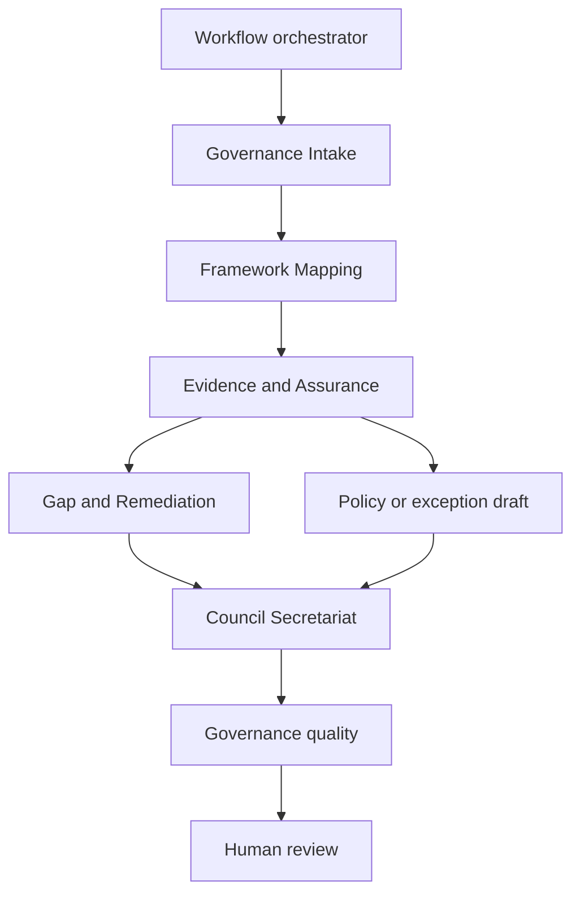

# GRAIL: Governance, Risk, Assurance & AI Lifecycle


**Enterprise AI and Model Risk Governance Control Plane.** Evidence-backed AI governance, from intake to executive decision.

GRAIL turns AI governance from disconnected documents into a traceable operating process:

- AI inventory;
- RACI and executive sign-off;
- responsible-AI gap assessment and remediation;
- governance KPIs and charter review;
- ISO/IEC 42001 control mapping;
- SOC 2 readiness;
- policy drafting and policy exceptions;
- council packs;
- an immutable audit trail.

## Product boundaries

GRAIL is a decision-support and workflow system:

- It never presents an AI-generated recommendation as a legal conclusion, an audit opinion, an ISO certification or an automatic approval.
- Readiness results are internal assessments, not SOC 2 reports.
- Control mappings are not certification.
- Every material decision needs a named human approver.
- All demonstration records are **synthetic demonstration data**.

## Demonstration and production sign-in

The preview sign-in page is a synthetic persona picker. It is not organization authentication.

A production deployment targets Amazon Cognito or enterprise SSO, multi-factor authentication, tenant isolation, session expiry, role and group mapping, privileged-access logging, and API authorisation that does not depend on the frontend. Those controls are recorded in `docs/adr/0008-authentication.md`. They are not enabled on the public preview.

## Current status

The public preview is a synthetic governance workspace. It is not a production deployment of the API, database or Step Functions.

| Area | State |
| --- | --- |
| Public homepage | Photographs, lifecycle, roles, safeguards and the agent-architecture diagram. First-visit introduction. |
| Frontend workspace | Seven-item navigation, role-aware Overview, lenses, AI-system tabs, assessments, evidence, remediation, exceptions, council and audit screens over synthetic seed data |
| Sign-in on the preview | Synthetic persona picker. Cognito is not connected. Production target controls are in `docs/adr/0008-authentication.md` |
| Deep links | CloudFront rewrites application routes, including control ids such as `iso-fg-6.1.2`, to `index.html`. Known asset extensions stay on S3 |
| Backend | Health, identity, RBAC mutation guards, append-only ethics workflow records and evidence objects with SHA-256, version, quarantine key and presign plan. Unit-tested. The preview does not call this API |
| Agents | This demonstration runs agents in deterministic mode. Production deployments can optionally use Amazon Bedrock for evidence-grounded drafting. Six workers return FinanceGuard drafts and stop for human review. No model is called from the preview |
| Step Functions | Definition scaffolded and validated. It is not executing in AWS |
| Database | Baseline migration validated offline. Aurora is not running for the preview |
| Terraform | Bootstrap and the static preview exist. The application stack (API, database, Cognito, evidence bucket, Step Functions) has not been applied |
| GitHub Actions | CI validates frontend, backend, Terraform and workflows on every pull request and main push. Protected development, test and production environments still need the OIDC setup in `docs/runbooks/github-and-aws-setup.md` before deploy workflows can apply AWS changes |

Still outstanding before the base can be called deployable: Cognito sign-in, Aurora repositories, the evidence bucket in AWS, council-pack export, the migration runner against a live database, and the threat model.

## Agent orchestration

The orchestrator is Step Functions plus deterministic routing. It pins the input record versions, runs the approved path and ends at Awaiting Human Review. It does not approve a record or invent a tool.



Governance Intake, Framework Mapping, Evidence and Assurance, Gap and Remediation, the policy or exception draft, and Council Secretariat are the agent steps in that workflow. Policy drafting and exception analysis share one worker, and a run selects one mode. RACI validation, SOC 2 readiness, KPI and charter triggers, and governance quality are deterministic services. Responsible AI Ethics and Data Governance and Lineage draft beside the workflow. An agent draft cannot override the deterministic services.

The public homepage shows this sequence as a compact summary. View detailed agent architecture opens the full diagram.

## FinanceGuard registration workflow

When FinanceGuard AI is registered, six drafts are produced in order and stop for a named person. The public preview shows that package on Overview. Accepting or rejecting a draft does not change the underlying record.

1. **Governance Intake** identifies sensitive financial and personal data and the need for enhanced human oversight. Preliminary materiality is a recommendation. The governance lead enters the system assessment and proposed risk tier.
2. **Framework Mapping** proposes the relevant Microsoft Responsible AI Standard v2, ISO/IEC 42001 and SOC 2 requirements. A mapping is not certification or equivalence.
3. **Evidence and Assurance** checks whether policies, testing notes and control evidence support those mappings, and reports stale or missing evidence. It does not mark evidence sufficient.
4. **Gap and Remediation** identifies the missing AI incident procedure and the missing human-review documentation, with owners and definitions of done. It does not close an action.
5. **Policy and Exception Drafting** writes a referenced policy draft for those gaps. A separate draft analyses exception REQ-0882. Neither draft approves a policy or an exception.
6. **Council Secretariat** produces a short executive paper requesting specific decisions, including holding No-Go until CC7.1 evidence is independently validated.

An authorised person can amend, accept or reject each draft. Every draft records its sources, assumptions, prompt template and version, that no model was called, confidence as an explanation rather than a threshold, token counts, estimated cost, latency and a SHA-256 output hash. On this preview the token count, cost and latency are zero because no model is called.

A new system can still be reviewed from Register AI system, or from the model-owner workbook at `frontend/public/templates/grail-governance-intake-sample.xlsx`.

## Deterministic services

These stay conventional code. An agent cannot override them:

- exactly one Accountable party and at least one Responsible party on each RACI task;
- KPI values and thresholds;
- charter-review triggers;
- evidence expiry and freshness;
- SOC 2 blocking rules, including a blocking Fail that cannot yield Go;
- separation of duties;
- workflow transition guards;
- audit-event creation;
- contradiction checks on a consolidated package.

## What agents cannot do

Agents cannot approve or deny an exception, accept risk, sign a RACI, close remediation, declare a control effective, claim ISO certification or SOC 2 assurance, change permissions, deploy infrastructure, send external messages, or override a deterministic rule.

The workflow orchestrator is AWS Step Functions, not an autonomous supervisor. It selects the approved path, retries transient failures and creates the human-review checkpoint. The preview demonstrates that checkpoint in the browser. The state machine is not running in AWS yet.

## Public preview

The static preview is https://d1nzcpi39ewygx.cloudfront.net. The homepage is public. Sign in as a synthetic persona to open the workspace. The preview does not call Amazon Bedrock, Cognito, the database or Step Functions. Homepage photographs are illustrative and AI-generated; they show no real customer, employee or patient data. Bedrock drafting can run only when `BEDROCK_ENABLED` is set outside local and CI.

## Prerequisites

| Tool | Version |
| --- | --- |
| Node.js | 24 LTS (`.nvmrc`), npm 11 |
| uv | 0.12 or later (installs Python 3.14 automatically) |
| Terraform | 1.16.x (≥ 1.10 required for S3 native locking) |
| Optional | tflint 0.64, Checkov (`uvx`), actionlint (`uvx --from actionlint-py`) |

## Project structure

```text
frontend/                 React + TypeScript + Vite application
backend/                  Python 3.14 package `grail`, Alembic migrations, tests
seed/                     Synthetic, provenance-tagged seed data (frameworks, demo)
infrastructure/terraform/ bootstrap, modules, environments/{development,test,production}
.github/workflows/        ci, deploy-development, deploy-environment (reusable), promote, drift-detection, security
docs/                     architecture, ADRs, runbooks, demonstration map
scripts/                  deterministic backend packaging
```

## Run locally

```bash
make install                 # uv sync + npm ci
make dev                     # http://localhost:5173, then choose a synthetic persona
```

The frontend reads synthetic seed data directly; it does not need a backend or AWS. Change persona to see the role-aware landing page, or switch between Executive View, Governance Workspace and Audit View in the top bar.

## Tests and checks

```bash
make backend-check     # Ruff, mypy strict, pytest (branch coverage ≥ 80%), schema drift
make frontend-check    # tsc, ESLint (incl. jsx-a11y), Vitest + axe, production build
make e2e               # Playwright smoke tests, desktop and mobile
make migrations-sql    # render migrations offline
make package           # deterministic Lambda zip and SHA-256
```

## Terraform validation

```bash
make tf-fmt tf-validate   # no backend, no AWS calls
make tf-lint tf-scan      # tflint (AWS ruleset), Checkov with documented skips
```

Planning against AWS needs `backend.hcl` and `terraform.tfvars`; copy them from the `.example` files, which are git-ignored when copied. Do this only after the bootstrap in the runbook.

## Environments and deployment

| Environment | Trigger | Protection |
| --- | --- | --- |
| development (`grail-development`) | CI success on `main` | Automatic; `allow_destroy = true` |
| test (`grail-test`) | `Promote` workflow with a commit already deployed to development | GitHub Environment approval |
| production (`grail-production`) | `Promote` with an annotated release tag on the tested commit | Required reviewers, deletion protection |

Artifacts are built once per commit and promoted by digest. They are never rebuilt.

**Deployment restrictions:**

- Do not run `terraform apply` or `destroy` for development, test or production from a laptop.
- Bootstrap resources and the static preview site exist in the portfolio account. The application stack (API, database, Cognito, Step Functions) has not been applied.
- Deploying that stack needs an explicit authorisation, a verified Aurora engine version, and the protected GitHub environment.

## Documentation

- `docs/architecture/overview.md`: architecture and the six-agent design
- `docs/architecture/cost-controls.md`
- `docs/architecture/security-boundaries.md`
- `docs/reference/demonstration-map.md`: source documents mapped to seed records, screens and workflows
- `docs/adr/`: decisions, including divergences from ATLAS

## Demonstration documents

The original PDF and DOCX files in `docs/reference/demonstrations/` are git-ignored until the owner confirms they may be published. The repository is public. The normalized seed data under `seed/` is the version-controlled source.
