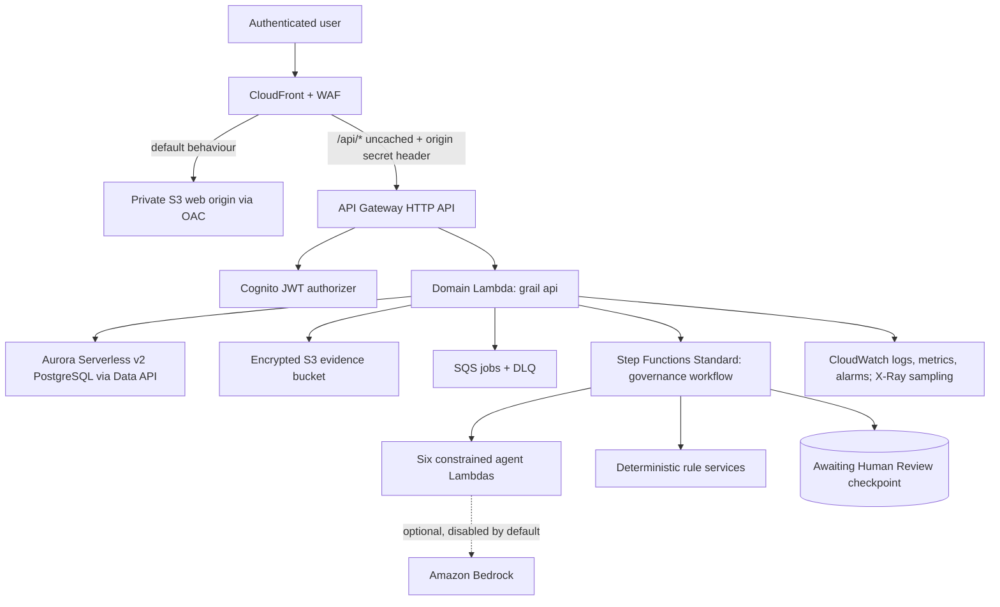

# GRAIL architecture overview

GRAIL (Governance, Risk, Assurance & AI Lifecycle) is a governance control plane for enterprise AI and model risk. It is a decision-support and workflow system. It never issues legal conclusions, audit opinions, certifications or automatic approvals.

Status: Stage 1 foundation. This page describes the target architecture. Each section is marked **Implemented (Stage 1)**, **Scaffold** or **Planned**.

## System context

## Frontend — Implemented (Stage 1 shell)

- React 19, TypeScript 6, Vite 8, React Router 8 and TanStack Query 5. Zod validates runtime configuration. React Hook Form and Recharts are deferred until a screen needs them; see ADR-0004.
- The shell is a midnight-navy sidebar with **exactly seven** primary items (Overview, AI Estate, Assess and Control, Actions, Decisions, Reports and Audit, Administration) on a light Cloud Grey workspace. A unit test enforces the count.
- The top bar always shows the organization, a data-as-of date and the active lens: Executive, Governance or Audit. The lens changes emphasis, never authorization.
- AI system pages use contextual tabs: Overview, RACI, Assessments, Controls and Evidence, Findings and Actions, Exceptions, Activity.
- Tokens are defined once in `frontend/src/styles/tokens.css`. A WCAG contrast test reads that file directly.
- Authentication: when the build has no Cognito configuration, a development-only persona stub signs the user in. The real Cognito code flow is a Stage 2 deliverable. A production build without Cognito configuration refuses to authenticate.
- Data: the Stage 1 screens read synthetic records adapted from `seed/demo`. Every surface shows the label "Synthetic demonstration data".

## Backend — Implemented (Stage 1 foundation)

- Python 3.14 package `grail` under `backend/src/grail`, packaged for AWS Lambda and managed with `uv`.
- Event adapter: one HTTP API Lambda (`grail.api.lambda_handler`) with a small explicit router. It has no web framework, which avoids extra cold-start cost and routing indirection (ADR-0005). Domain logic never imports the adapter.
- Cross-cutting pieces: typed configuration (`pydantic-settings`), structured JSON logging with a correlation ID, and a consistent error envelope (`code`, `message`, `field_errors`, `request_id`).
- Routes: `GET /v1/health` (unauthenticated, reveals nothing) and `GET /v1/me` (authenticated sample that returns the caller's identity and organization membership).
- Identity comes **only** from API Gateway's validated JWT claims, plus a membership lookup through a repository interface. A caller-supplied organization ID is treated as a request to check, never as proof of membership.
- Domain packages with documented contracts: auth, organizations, inventory, frameworks, assessments, controls, evidence, raci, remediation, kpis, charters, policies, exceptions, approvals, reports, audit, orchestration, agents, prompts.

## Aurora PostgreSQL — Scaffold

- Aurora Serverless v2 PostgreSQL with Data API enabled, RDS-managed master credentials in Secrets Manager, encryption at rest, 0 ACU minimum, 5-minute auto-pause and 2 ACU maximum.
- Placed in a dedicated private VPC with no internet gateway and no NAT. The Lambdas stay outside the VPC and reach the database only through the Data API.
- Migrations: SQLAlchemy 2 metadata plus Alembic. CI validates them offline with `alembic upgrade head --sql`. The deploy step will run the rendered SQL through the Data API (ADR-0006). The baseline migration creates `organizations`, `users`, `memberships` and an append-only `audit_events` table.

## Authentication — Scaffold

- A Cognito user pool with self-sign-up disabled, so administrators create users. It has strong password policy, optional TOTP MFA, a public app client using authorization code + PKCE, and a resource server scope `grail-api/access`.
- The API Gateway JWT authorizer validates issuer, audience and scope on every protected route.
- Tokens are held in memory in the browser, never in `localStorage`. Silent renewal is designed in Stage 2.

## Evidence storage — Scaffold

- A separate S3 bucket. It is versioned, blocks all public access, enforces bucket-owner object ownership, uses SSE-S3 encryption and denies requests without TLS.
- Prefixes: `quarantine/` (expires after 1 day) and `evidence/` (validated objects; noncurrent versions expire after the configured retention). Uploads and downloads use short-lived presigned URLs. Lambda never proxies large files.
- Malware scanning is not provisioned in the portfolio environment, so public uploads stay disabled. This limitation is documented (security-boundaries.md).

## Deterministic rule services — Implemented (first set)

Pure Python functions that can be tested without AWS:

| Service | Module | Stage 1 |
| --- | --- | --- |
| RACI validation (exactly one A, at least one R, no empty task or orphan role, concentration warning) | `grail.raci.validation` | Implemented and tested |
| SOC 2 readiness recommendation (Go, Conditional Go, No-Go) | `grail.controls.soc2_readiness` | Implemented and tested |
| Role-permission authorization decision | `grail.auth.authorization` | Implemented and tested |
| Agent output schema validation and tool-allowlist enforcement | `grail.agents.validation` | Implemented and tested |
| Gap prioritization, KPI thresholds, charter triggers, evidence freshness, exception risk | respective packages | Contracts documented; Stage 2–3 |

## Step Functions orchestration — Scaffold

The Standard Workflow definition lives at `backend/src/grail/orchestration/governance_workflow.asl.json`. Terraform renders it with the agent function ARNs. Flow:

1. `ValidateRequest` checks tenant, role, system and workflow type deterministically.
2. `CreateExecutionManifest` records the input record versions immutably.
3. `GovernanceIntake` runs.
4. `FrameworkMapping` runs, then `EvidenceAssurance`.
5. In parallel: `GapRemediation`, plus `PolicyExceptionDrafting` when relevant.
6. `CouncilSecretariat` runs.
7. `GovernanceQualityChecks` runs deterministically.
8. `PersistProposals` saves the outputs as Draft.
9. `AwaitingHumanReview` ends the workflow successfully.

Each agent task retries only transient errors, with bounded backoff and jitter. A schema failure or policy denial routes to `RecordPartialCompletion` without a retry. The workflow never waits for a human. It ends at the checkpoint, and an authorized approval event starts a new execution (ADR-0007).

## Initial six-agent architecture — Contracts implemented, workers scaffolded

| Worker | Technical ID | Output |
| --- | --- | --- |
| Governance Intake | `governance_intake` | Inventory proposal, missing-information questions, preliminary materiality |
| Framework Mapping | `framework_mapping` | Candidate mappings with rationale, sources, assumptions |
| Evidence and Assurance | `evidence_assurance` | Evidence relevance/freshness observations, unsupported-control warnings |
| Policy Gap and Remediation | `gap_remediation` | Draft findings and remediation actions with definitions of done |
| Policy and Exception Drafting | `policy_exception_drafting` | Serves the `policy_drafting` and `policy_exception` catalogue entries, each with its own prompt and schema |
| Council Secretariat | `council_secretariat` | Draft council pack, decision requests, conditions |

The remaining catalogue entries are `accountability_raci`, `soc2_readiness`, `kpi_charter` and `governance_quality`. They are disabled in `agent_catalog.json`; their logic runs as deterministic services. Every agent receives a versioned input envelope and returns schema-validated JSON containing provenance, assumptions, missing information, warnings, metrics and a content hash. Agents may write **only** to proposal storage, and their tool allowlists contain only read and propose tools. Bedrock is disabled by default. When Bedrock is disabled, the workers return deterministic seeded drafts labelled as such. No Bedrock call exists in Stage 1.

## Human-review checkpoints — Contract implemented

`grail.orchestration.checkpoints.HumanReviewCheckpoint` records the execution, the proposals awaiting review, the required reviewer role, the due date and the status (`Awaiting Human Review`, `Accepted`, `Edited`, `Rejected`). Only an authorized human action changes the authoritative records. That action is written to the audit trail and may start a continuation workflow.

## Observability — Scaffold

- Structured JSON logs carry `request_id` and `correlation_id`. Full prompts, evidence and generated content are never logged.
- An SNS alarm topic is provisioned. Alarms cover API 5xx responses, Lambda errors, DLQ depth and failed Step Functions executions. A minimal CloudWatch dashboard is included, and all log groups retain logs for 14 days by default.
- An AWS Budgets monthly cost budget sends notifications at 80% actual and 100% forecast spend.

## Environments and promotion — Scaffold

| Environment | Prefix | Trigger | Protection |
| --- | --- | --- | --- |
| development | `grail-development` | Successful CI on `main` | Automatic; controlled destroy allowed by variable |
| test | `grail-test` | Manual `promote.yml` from a verified development manifest | GitHub Environment approval |
| production | `grail-production` | `promote.yml` with an annotated release tag, from the tested manifest | Required reviewer, deletion protection, no reset |

Artifacts are built once per commit. The Lambda zips and the frontend bundle are published under commit-addressed keys with SHA-256 digests. A deployment manifest records the commit, digests, migration head and plan metadata. Promotion re-verifies the digests and never rebuilds. Each environment has its own Terraform state key (`grail/<environment>/terraform.tfstate`), data stores, Cognito pool and OIDC role.

## Related documents

- [repository-plan.md](repository-plan.md): file tree and stage plan
- [cost-controls.md](cost-controls.md)
- [security-boundaries.md](security-boundaries.md)
- [../reference/demonstration-map.md](../reference/demonstration-map.md)
- [../adr/](../adr/): architecture decision records
